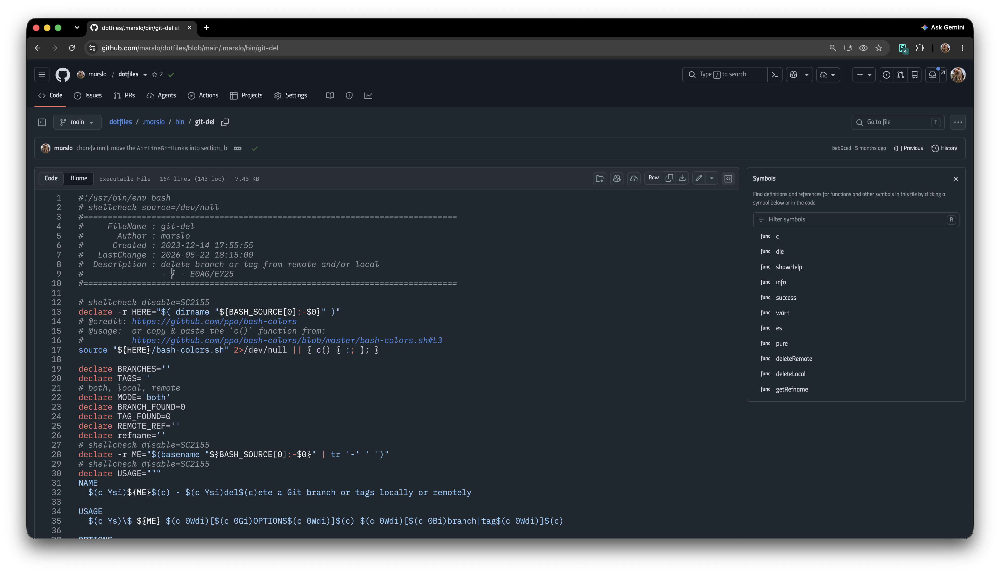

# iFonts Github (marslo)

github-only font customization — by [Marslo Jiao](mailto:marslo.jiao@gmail.com)

## installation

- install stylus extension for [Stylus for Chrome](https://chrome.google.com/webstore/detail/stylus/clngdbkpkpeebahjckkjfobafhncgmne) | [Stylish for Chrome](https://chrome.google.com/webstore/detail/stylish-custom-themes-for/fjnbnpbmkenffdnngjfgmeleoegfcffe) | [Firefox](https://addons.mozilla.org/pt-BR/firefox/addon/styl-us/) | [edge](https://chromewebstore.google.com/detail/stylus/clngdbkpkpeebahjckkjfobafhncgmne)
- click to install 📦 [marslo/ifonts-github](https://github.com/marslo/ifonts-github/raw/main/ifonts-github.user.css) | [iFonts Github (marslo)](https://userstyles.world/api/style/30123.user.css)
- click to install siblings
  - 📦 [marslo/ifonts (for universal domains)](https://github.com/marslo/ifonts/raw/main/ifonts.user.css) | [iFonts (marslo) for universal domains](https://userstyles.world/api/style/5264.user.css) | 🏘 [marslo/ifonts](https://github.com/marslo/ifonts)
  - 📦 [marslo/ifonts-jenkins](https://github.com/marslo/ifonts-jenkins/raw/main/ifonts-jenkins.user.css) | [iFonts Jenkins (marslo)](https://userstyles.world/api/style/30122.user.css) | 🏘 [marslo/ifonts-jenkins](https://github.com/marslo/ifonts-jenkins)

## fonts download

> - more details : [iMarslo: fonts](https://marslo.github.io/ibook/tools/fonts.html)

### sans

- [Recursive Sans Casual Static Nerd Font](https://github.com/marslo/fonts/tree/fonts/Recursive/Recursive_Desktop_NF/ttf) | [Recursive Sans Casual Static](https://github.com/arrowtype/recursive/releases) | [Recursive](https://www.recursive.design/)
- [ubuntu](https://design.ubuntu.com/font) | [preview](https://fonts.google.com/specimen/Ubuntu)
- [Candara Nerd Font](https://github.com/marslo/fonts/tree/fonts/Candara) | [Candara](https://www.dafontfree.io/candara-font)
- [Gisha Nerd Font](https://github.com/marslo/fonts/tree/fonts/Gisha) | [Gisha](https://learn.microsoft.com/en-us/typography/font-list/gisha)
- [Titillium Nerd Font](https://github.com/marslo/fonts/tree/fonts/Titillium) | [Titillium](https://fonts.adobe.com/fonts/titillium-web) | [preview](https://fonts.google.com/specimen/Titillium+Web)

### mono

- [BlexMonoLig Nerd Font Mono](https://github.com/marslo/fonts/tree/fonts/Blex/IBMPlexMonoLigNF)
- [LektonLig Nerd Font Mono](https://github.com/marslo/font-lekton/tree/main/LektonLigNF) | [LektonLig Nerd Font Mono](https://github.com/marslo/fonts/tree/fonts/Lekton/LektonLigNF)
- [OperatorMonoLig Nerd Font Mono](https://github.com/marslo/fonts/tree/fonts/Operator/OperatorMonoLigNF) | [OperatorMono Nerd Font Mono](https://github.com/marslo/fonts/tree/fonts/Operator/OperatorMono)
- [Monaco Nerd Font Mono](https://github.com/marslo/fonts/tree/fonts/Monaco) | [Monaco](https://www.cufonfonts.com/font/monaco)
- [RecMonoCasual Nerd Font Mono](https://github.com/marslo/fonts/tree/fonts/Recursive/Recursive_Code_NF/RecMonoCasual) | [Rec Mono Causal](https://github.com/arrowtype/recursive/tree/main/fonts/ArrowType-Recursive-1.085/Recursive_Code)
- [ComicMono Nerd Font Mono](https://github.com/marslo/fonts/tree/fonts/ComicMono) | [Comic Mono](https://dtinth.github.io/comic-mono-font/)
- [Gohu](https://github.com/ryanoasis/nerd-fonts/tree/master/patched-fonts/Gohu)
- more:
  - [Nerd Fonts Patched by v3.2.1.1](https://github.com/marslo/fonts/tree/fonts) | [nerd-font](https://www.nerdfonts.com/font-downloads) | [ryanoasis/nerd-fonts](https://github.com/ryanoasis/nerd-fonts)
  - [powerline/fonts](https://github.com/powerline/fonts)
